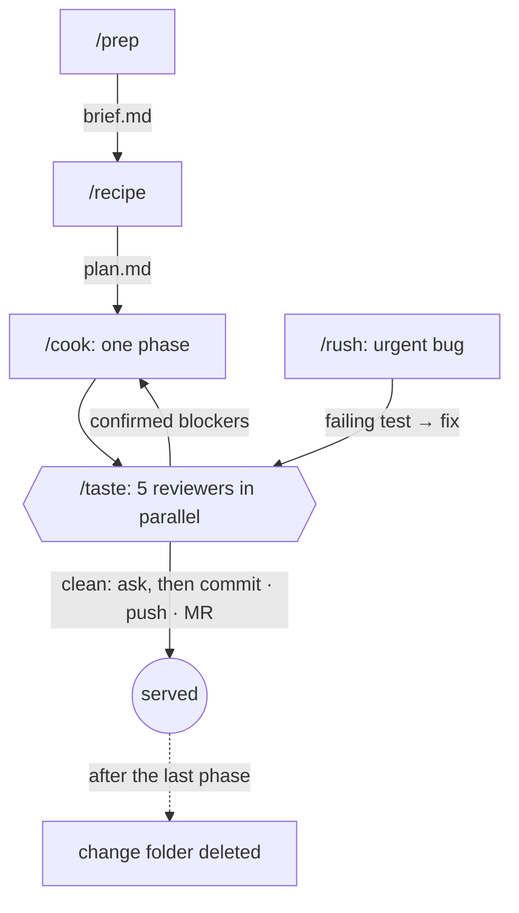

# agent-workflow-kit

Meally's AI development workflow, packaged for any repository and any stack.
A change goes through the kitchen: **prep** decides what to make, the
**recipe** says how, **cook** builds it one phase at a time, five reviewers
**taste** it before it's served, and the change's folder is cleaned away when
it ships. Hooks turn written rules into enforced ones, and an **inspection**
grades any repository's `AGENTS.md` / `CLAUDE.md` from A to D.

It grew out of building [Meally](examples/meally/README.md), a Flutter app
shipping on iOS, Android and the web, with AI agents since May 2026. Most of
its rules trace back to something that went wrong there; see
[design decisions](docs/design-decisions.md). The kit was extracted from
Meally's private repository, where its full history lives (103 merged pull
requests since May 2026), so this repository starts at the extraction rather
than at the first experiment.

## Why a kitchen

Meally is a recipe app, and professional kitchens solved long ago the problem AI
agents have: many hands, one standard, and nothing leaves untasted.

| In a kitchen | Here |
| ------------ | ---- |
| **Mise en place:** everything decided and within reach before cooking | `/prep` settles the user's decisions in one round of questions and writes a brief |
| **The recipe** | `/recipe` writes the plan: tasks with files and tests, edge states, data risks, phases |
| **One course at a time** | `/cook` builds one phase, which becomes one merge request |
| **Tasting before the pass** | `/taste` sends five reviewers at once; every blocker is confirmed against the code |
| **The rush order** | `/rush` fixes an urgent bug: failing test first, smallest fix, still tasted |
| **Clean as you go** | Each change lives in one folder, deleted when its last phase ships |
| **The health inspection** | `/inspect` grades agent docs A to D, with evidence for every point |

Inspection grades: **A** 90–100 · **B** 75–89 · **C** 60–74 · **D** under 60, out of the [100-point rubric](docs/agent-docs-rubric.md).

## The workflow



In words: `/prep` writes a brief, `/recipe` writes the plan, and `/cook` builds
one phase at a time, has five reviewers taste each one, and commits nothing
until you say so. `/rush` is the fast path for urgent bugs.

Each step reads the file the previous one wrote, so the context can be cleared
between steps without losing anything. Details in [docs/workflow.md](docs/workflow.md).

Every change lives in one folder:

```text
docs/changes/
├── 2026-10-22-csv-export/
│   ├── brief.md    # /prep: the decisions and why they were made
│   └── plan.md     # /recipe: phases, tasks, tests, edge states, data safety, Status line
└── .tasting/       # reviewers' notes: git-ignored, deleted after each tasting
```

## What's inside

| Part | Contents |
| ---- | -------- |
| [Skills](skills/) | `/adopt`, `/prep`, `/recipe`, `/cook`, `/taste`, `/rush`, `/inspect` |
| [Agents](agents/) | `codebase-explorer` plus five reviewers: rules, tests, data safety, docs drift, pre-merge |
| [Hooks](hooks/) | Block edits to protected files, format on edit, paired-file reminders, rule-breaking code patterns, change-folder status. 29 tests. |
| [Stack packs](stacks/) | Everything language-specific, as data for hooks and prose for AGENTS.md. Ships with Flutter. |
| [Template](template/) | `AGENTS.md`, `CLAUDE.md`, `.claude/settings.json` and `docs/changes/` for a repository |
| [Rubric](docs/agent-docs-rubric.md) + [checker](scripts/agent_docs_check.py) | A 100-point grade for agent docs, with a script for the mechanical half. 12 tests. |
| [Evals](evals/README.md) | 7 behaviour cases for the skills, reviewers and hooks, each scored against a no-plugin baseline |
| [CI templates](template/ci/agent-workflow.gitlab-ci.yml) | GitLab include and GitHub workflows: the checker on every merge request, a headless `/taste` with its cost, a weekly `/inspect` |
| [MCP guide](docs/mcp.md) | Code host, database and monitoring servers: reads allowed, writes asked, destructive tools denied |
| [Worked example](examples/meally/README.md) | Meally's real setup inspected: 60 (C) before, 91.25 (A) after |

## Quick start

Install the plugin in Claude Code:

```text
/plugin marketplace add MaTeS72/agent-workflow-kit
/plugin install agent-workflow-kit@agent-workflow-kit
```

Then, inside a repository:

```text
/adopt           # writes AGENTS.md, CLAUDE.md, .claude/agent-workflow.json from the code
/inspect         # grades the result A to D
/prep <idea>     # start the first change
```

Plugin commands are namespaced: if another plugin also has a `/prep`, type `/agent-workflow-kit:prep`. To try the kit from a clone without installing it: `claude --plugin-dir /path/to/agent-workflow-kit`.

## Commands

| Command | Does | Started by |
| ------- | ---- | ---------- |
| `/adopt [stack]` | Sets a repository up from the template and a stack pack, using facts the explorer cites; unknowns become `TODO(owner)` questions | user only |
| `/prep <idea>` | Asks every decision the user owns in one round of multiple-choice questions, offers 2–3 approaches, writes `brief.md` | user or Claude |
| `/recipe [change]` | Writes `plan.md`: tasks with files and tests, edge states, data safety, phases of one merge request each | user or Claude |
| `/cook [change]` | Cooks the next phase, has it tasted, updates the status, and serves only after asking | user only |
| `/taste [paths]` | Five reviewers in parallel; blockers confirmed against the code before anyone acts | user or Claude |
| `/rush <bug>` | Root cause, failing test, smallest fix, three or four reviewers | user only |
| `/inspect [repo]` | Grades agent docs against the rubric and ranks fixes by points recovered | user or Claude |

Commands with side effects (committing, pushing, writing many files) set
`disable-model-invocation`, so Claude never starts them on its own.

## Reviewers

| Agent | Model | Tastes for |
| ----- | ----- | ---------- |
| `codebase-explorer` | sonnet | (Not a reviewer.) A read-only map of the code relevant to a task, as `file:line` pointers |
| `rules-reviewer` | inherit | Regressions, the project's own rules, layering, and complexity or scope the change doesn't need |
| `test-reviewer` | sonnet | "If this broke tomorrow, which test would fail?" — including every edge state the recipe lists |
| `data-safety-reviewer` | inherit | Anything that can lose, corrupt or leak user data, from real Meally incidents |
| `docs-drift-reviewer` | sonnet | Durable docs the change made false; the change folder's status |
| `premerge-checker` | haiku | Format, lint, tests, debug leftovers, secrets, commit messages |

Findings are labelled **blocker**, **should-fix** or **nit**. Each reviewer
writes full notes to `docs/changes/.tasting/` and returns at most 12 lines, so a
five-reviewer tasting costs the main context about 60 lines.

## Hooks

The hooks know no language. Each project describes its rules in
`.claude/agent-workflow.json` ([schema](schema/agent-workflow.schema.json)):

```json
{
  "protected": [
    { "glob": "**/*.g.dart", "reason": "Generated. Edit the source, then run build_runner." },
    { "glob": "db/migrations/**", "reason": "Applied migrations are immutable.", "allowCreate": true }
  ],
  "formatOnEdit": [{ "glob": "**/*.go", "command": "gofmt -w {file}" }],
  "pairedFiles": [{ "glob": "lib/l10n/app_*.arb", "reminder": "Update every ARB file, then run gen-l10n." }],
  "patterns": [{ "glob": "lib/**/*.dart", "regex": "Widget\\s+_build\\w*\\(", "message": "Extract a StatelessWidget." }]
}
```

`patterns` check only the text an edit adds, so old code doesn't cause noise. A blocked edit returns exit 2 with the reason on stderr, which Claude reads.
Reminders travel as `additionalContext`, because a PostToolUse hook's plain
stdout [only reaches the debug log](https://code.claude.com/docs/en/hooks).
Meally's original reminder hook had that bug for five months.

## Rolling out across many repositories

1. Commit the template's `.claude/settings.json` to each repository: it registers this marketplace, enables the plugin, and holds `git commit` / `git push` behind a prompt. Each collaborator installs the plugin once with `claude plugin install agent-workflow-kit@agent-workflow-kit --scope project` after trusting the folder.
2. Run `/adopt` once per repository. It picks the stack pack from marker files (`go.mod`, `build.gradle.kts`, `package.json`, …) and leaves `TODO(owner)` where the code doesn't answer a question.
3. Add a stack pack per language once (`stacks/<stack>/`, two files, no code), and every repository on that stack shares it.
4. Wire up MCP once per organisation (code host, database, monitoring) with reads allowed and writes held back by permission rules; see [docs/mcp.md](docs/mcp.md).
5. Add the CI jobs. On GitLab it's one include, and the free checker gates every merge request while a headless `/taste` posts its report and cost as a note; a pipeline schedule with `AGENT_JOB=inspect` adds the weekly `/inspect`:

   ```yaml
   include:
     - remote: https://raw.githubusercontent.com/MaTeS72/agent-workflow-kit/main/template/ci/agent-workflow.gitlab-ci.yml
   ```

   On GitHub, copy `template/.github/workflows/agent-taste.yml` and `agent-inspect.yml`.

## Outcomes and cost

**On Meally.** Since the agent setup went in on 19 May 2026: 103 pull requests
merged (#15 to #151) and 202 commits on `main`, by one developer. Every pull
request passes a per-language import quality gate; a weekly job replays the
corpus against production.

**Cost is designed in, not discovered on the invoice:**

- **Price a paid run before running it.** Evals, backfills and model comparisons get a call count and an estimate first. Meally's model choice cost $0.96 of eval calls and picked a model at $0.00141 per import over one at $0.00332, at the same measured quality.
- **Pay for the job, not the context.** Mechanical checks run on haiku and reviews on sonnet; each reviewer returns at most 12 lines, so a five-reviewer tasting costs the main context about 60.
- **A ceiling on every unattended run.** CI runs carry `--max-budget-usd` and print `total_cost_usd` under every comment; evals carry `--max-cost-usd`, and the smoke cases need no judge model.
- **The prompts are measured too.** [Evals](evals/README.md) score each skill against a no-plugin baseline, so a prompt change or a new model can't quietly make the kit worse.

## What works, and what doesn't

From building Meally with agents every day since May 2026.

### Works

- **Rules that carry their reason.** "Never edit generated files: build_runner overwrites them" ends the discussion; a bare "never" gets argued with.
- **A hook for every rule a script can check.** A blocked edit can't happen; a prose rule only makes it rarer.
- **Clearing the context between steps.** A brief and a plan on disk carry everything the next step needs; a long conversation mostly carries noise.
- **Several narrow reviewers instead of one broad one,** and confirming their blockers before acting on them.
- **Evals for AI features.** Meally's AI recipe import is scored per language against hand-checked ground truth on every pull request, and the gate fails if any language regresses against `main`. The model was picked the same way: three candidates tied on a measured eval, so the cheapest won.
- **Parity checks for mirrored logic.** Meally's recipe parsing lives in Dart, TypeScript and Swift; one script replays a frozen corpus through all three and fails when they disagree.

### Doesn't work

- **Housekeeping rules written only in prose.** Meally's docs said to keep each plan's status current; five of six plans didn't.
- **Hook messages on stdout.** Claude never saw Meally's ARB reminder.
- **Background work in hooks.** Two concurrent `build_runner` runs deleted each other's output.
- **Prompt instructions that branch on a guess.** A per-language "keep the text in English" instruction translated French recipes into English whenever language detection fell back to `en`. The prompt now says "preserve the original language", unconditionally.
- **Blaming the model first.** An import invented three different recipes in three runs; the payload turned out to be "5:30", because the pre-trim picked the page's first `<article>`. The fix was choosing the block that looks like a recipe and telling the model to use only what it's given.

## Development

```bash
python3 -m unittest discover -s hooks/tests      # hook behaviour, Flutter and Go fixtures
python3 -m unittest discover -s scripts/tests    # checker behaviour
python3 scripts/agent_docs_check.py . --exclude template --exclude examples --strict
claude plugin validate .

# Behaviour evals: paid model calls, so price them first (evals/README.md)
claude plugin eval . --tag smoke --ablation none --runs 1 --trust-plugin --scaffold --allow-tools Write Edit --max-cost-usd 2
```

`claude plugin validate .` passes with two expected warnings: this repo's own
`CLAUDE.md` (it's for working on the kit, not context shipped with the plugin)
and the missing directory icon. CI runs the free checks above plus a Markdown
lint on every pull request; the evals run only on demand. See
[CONTRIBUTING.md](CONTRIBUTING.md) for adding commands, reviewers and stack packs.

## License

[MIT](LICENSE)
