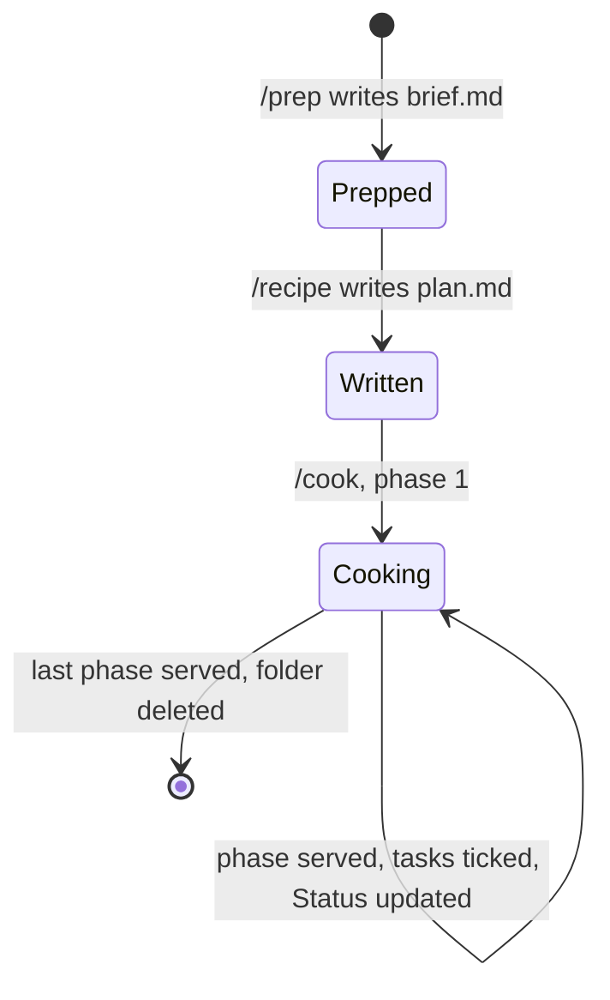
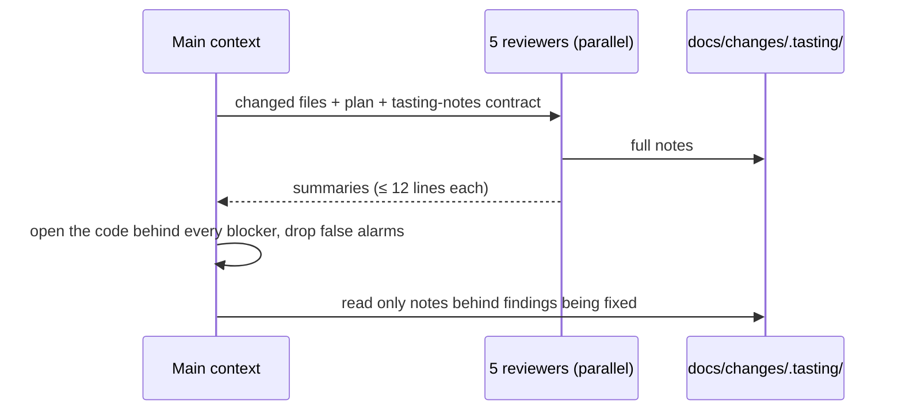

# The workflow

Five commands, each with a fixed input and output on disk. Any step can start
from a cold context: everything it needs is in a file the previous step wrote.

| Step | Reads | Writes | Ends with |
| ---- | ----- | ------ | --------- |
| `/prep` | AGENTS.md, the explorer's map | `docs/changes/<date>-<slug>/brief.md` | The user's decisions, each with its reason |
| `/recipe` | The brief, the nested CLAUDE.md files of touched directories | `plan.md` in the same folder | Tasks with files and tests, edge states, data safety, phases |
| `/cook` | The plan and the files it names | Code, tests, ticked tasks, tasting notes (temporary) | One phase served, after the user says so |
| `/taste` | The branch diff | Tasting notes (temporary) | Confirmed findings, and the fixes the user picked |
| `/rush` | The bug report | A regression test and a fix | A `fix:` merge request, after the user says so |

## Between steps

Each step ends with a single line naming the next one, such as
`Next: /clear, then /recipe docs/changes/2026-10-22-csv-export`. A fresh context
works better than one still carrying the prep conversation, and nothing is lost
because the next step reads the folder.

## One folder per change

- A change's brief and plan sit side by side in one folder, so they can't drift apart in two places.
- The plan's `Status:` line is the change's status; once the plan exists, the brief's says `see plan.md`. The post-edit hook reminds Claude when a status is missing, and `scripts/agent_docs_check.py` fails CI on it.
- The first phase's commit includes the folder, and the approved commit for the last phase removes it. Git history keeps it; the tree holds only work that is still live. Nothing is deleted before the user approves the commit.
- Tasting notes live in `docs/changes/.tasting/`, which is git-ignored and deleted after each tasting.

## Tasting

Every reviewer uses the same three labels:

- **blocker:** bug, data loss, security hole, red build, untested new logic, a broken absolute rule. Fixed before merge.
- **should-fix:** convention slip, weak test, stale doc. Fixed in this change unless the user decides otherwise.
- **nit:** goes into the merge request description.

## In CI

The same steps run without anyone at the keyboard, from the
[GitLab include](../template/ci/agent-workflow.gitlab-ci.yml) or the
[GitHub workflows](../template/.github/workflows/):

| Job | When | Gates the merge? |
| --- | ---- | ---------------- |
| Agent docs checker | Every merge request | Yes. Free and deterministic |
| `/taste report-only` | Every merge request | No. Posts the report and its cost as a note, and flags blockers |
| `/inspect report-only` | Weekly | No. Opens an issue with the grade |

Headless runs can't ask questions, so both skills have a report-only mode that
changes nothing except the notes, and every run carries a budget ceiling.

## Limits that keep agents honest

- **Three attempts.** A failing check gets three fix attempts, then the user gets the error and the fixes already attempted.
- **One phase per run.** `/cook` never chains phases; each one is tasted and merged alone.
- **The recipe is the scope.** Work outside it is a question for the user, and the rules reviewer flags it.
- **Humans own irreversible steps.** Commit, push and merge request each need a yes in the current session.
- **No weakened tests.** Skipping, deleting or loosening a test to go green is forbidden.
